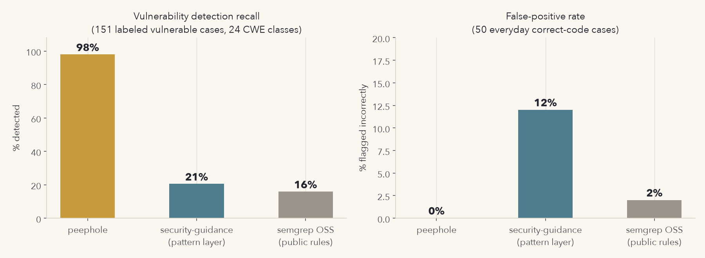
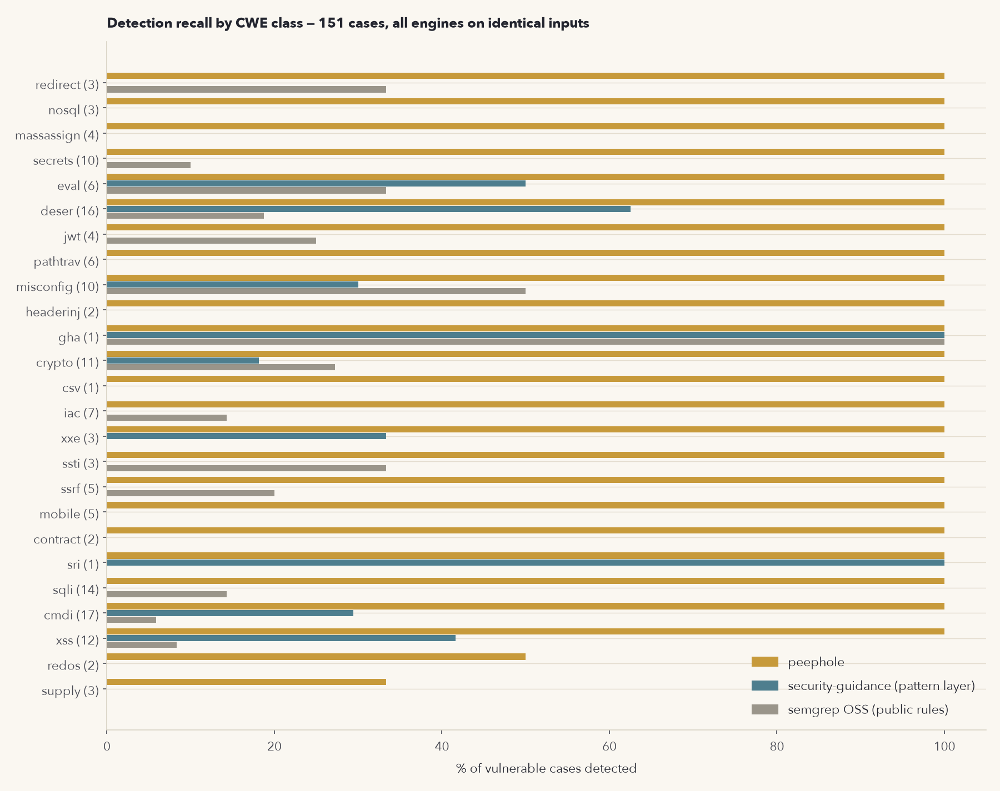
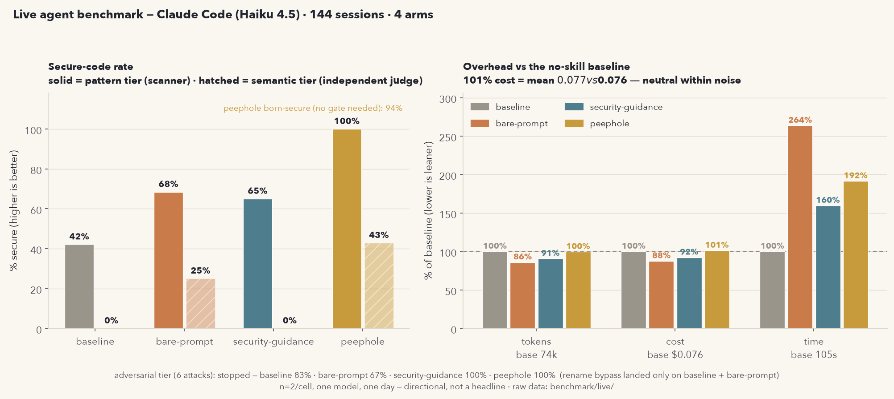
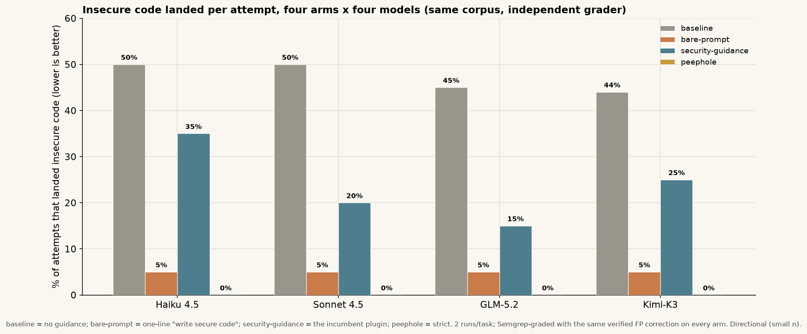

<p align="center">
  <picture>
    <source media="(prefers-color-scheme: dark)" srcset="assets/wordmark-dark.svg">
    
  </picture>
</p>

<p align="center">
  <b>Born-secure enforcement for AI coding assistants.</b>
</p>

<p align="center">
  
  
  
  
  
</p>

Peephole is a security gate for AI coding agents. It catches insecure code at
*write time*, before it lands on disk, and records every decision in a
CWE-mapped, tamper-evident audit log. *Never open the door before checking who's
on the other side, and never ship code before checking what's in it.*

By default (**`guided`** mode) it is developer-first: every finding is surfaced
as a prompt and the call is yours — you stay in control, nothing is hard-blocked
(only tampering and explicit org mandates ever deny). Opt into **`strict`** /
**`hardened`** and it *denies before* the write (PreToolUse) where the incumbent
plugin only warns *after* one lands (PostToolUse, detect-then-regenerate): the
insecure hunk never touches disk, so code is *born* secure, not repaired. It's a
single **static Go binary** — no Node, no Python,
no runtime — with a ~4ms hook path for a typical write (larger writes scale with
size; the 256KB hot-path window is retro-scanned beyond that). See
[docs/DESIGN.md](docs/DESIGN.md) for the architecture and platform contract.

**Docs:** [Design](docs/DESIGN.md) · [Benchmark](docs/BENCHMARK.md) · [Integrations](docs/INTEGRATIONS.md) · [Review history](docs/REVIEW.md) · [Contributing](CONTRIBUTING.md) · [Security](SECURITY.md) · [Changelog](CHANGELOG.md)

> **Not just Claude Code.** The same binary hard-blocks writes in Gemini CLI,
> OpenAI Codex CLI, Qwen Code, Charm Crush, and Cursor (plus OpenCode via its
> plugin) — every host that honors `peephole hook --exit2`'s exit-code-2 block
> signal — with a universal `git pre-commit` backstop for everything else. See
> [docs/INTEGRATIONS.md](docs/INTEGRATIONS.md) for drop-in configs, the coverage
> matrix, and the honest caveats (which hosts can't hard-block yet).

## Install

**As a binary** (any agent, git hook, or CI). This detects your OS and
architecture, installs to your `PATH`, and smoke-tests it — macOS and Linux:

```sh
os=$(uname -s|tr '[:upper:]' '[:lower:]'); arch=$(uname -m|sed 's/x86_64/amd64/;s/aarch64/arm64/'); curl -fsSL "https://github.com/akashsebastian333/peephole/releases/latest/download/peephole-${os}-${arch}" -o peephole
chmod +x peephole && sudo mv peephole /usr/local/bin/peephole
```

Then `peephole scan yourfile.py` to smoke-test.

Windows: download `peephole-windows-amd64.exe` from the
[latest release](https://github.com/akashsebastian333/peephole/releases/latest)
and add it to your `PATH`.

To verify the download against the release checksums before installing:

```sh
curl -fsSLO "https://github.com/akashsebastian333/peephole/releases/latest/download/SHA256SUMS"
shasum -a 256 -c SHA256SUMS --ignore-missing   # 'sha256sum -c' on Linux
```

Wiring for Gemini CLI, Codex, Cursor, MCP/LSP editors, and a universal
`git pre-commit` hook is in [docs/INTEGRATIONS.md](docs/INTEGRATIONS.md).

**As a Claude Code plugin** (local CLI, desktop, or the web/cloud IDE). Add the
marketplace and install — hooks auto-register, default mode is **guided**
(surfaces issues as prompts, never hard-blocks; `/peephole strict` to enforce):

```
/plugin marketplace add akashsebastian333/peephole
/plugin install peephole@peephole
```

## Supported agents & IDEs

The engine is a single binary (stdin event → allow/ask/deny); only the
integration point differs per host. Drop-in configs are in [`integrations/`](integrations/);
full setup and the coverage rationale are in
[docs/INTEGRATIONS.md](docs/INTEGRATIONS.md).

| Integration | Blocks before write? | Agents / IDEs |
|---|---|---|
| **Native pre-tool hook**: `peephole hook --exit2` | **Yes, hard** (deny) | Claude Code · Gemini CLI · OpenAI Codex CLI · Qwen Code · Charm Crush · Cursor *(shell + MCP paths)* |
| **In-process plugin**: shells to the hook | **Yes, hard** | OpenCode |
| **git pre-commit**: `peephole scan --gate --staged` | **Yes, at commit** | Universal, any git repo (Aider auto-commits, so effectively per edit) |
| **MCP server**: `peephole mcp` | Advisory | Windsurf · Trae · Tongyi Lingma (通义灵码) · Comate (文心快码) · CodeGeeX · iFlyCode · Qoder · + the MCP mode of any CLI agent |
| **LSP diagnostics**: `peephole lsp` | Warn only | Zed · JetBrains AI · VS Code / GitHub Copilot |

Only hooks and in-process plugins can *veto* a write pre-emptively. Most editors
expose only post-hoc events or diagnostics, so there peephole *advises* (MCP/LSP)
and the real block is the git pre-commit hook.

**Honest coverage caveats.** A hook host hard-blocks only if it honors the block
signal (exit code 2). Verified for the six exit-2 hosts above and OpenCode's
plugin (reads exit 2). **Not** verified for **Block Goose** (no external hook
system — use the git/MCP backstop), **Cline** (in-process SDK; needs a plugin
that returns `{approved:false}` on exit 2 — not yet shipped), and **Sourcegraph
Amp / OpenHands** (plugin unverified); treat those as advisory + git-backstop
until a working plugin ships. Also, exit-2 hosts enforce **deny only** — a
lower-confidence *ask* finding (e.g. `curl … | bash`) passes on them, whereas
Claude Code surfaces it as an approval prompt. See
[docs/INTEGRATIONS.md](docs/INTEGRATIONS.md).

## Modes

| Mode | Behavior |
|---|---|
| `guided` | **developer-first default.** Every finding is surfaced as an **ask** — you decide at the prompt; nothing is hard-blocked. Self-protection and explicit org mandates still deny. *(default)* |
| `audit` | warn + log only; never prompts or blocks. Measure before you enforce. |
| `strict` | **deny** high-confidence CWE patterns, **ask** on lower-confidence ones. Opt in for blocking. |
| `hardened` | deny-by-default; deny unverified installs and uninspectable writes. |
| `off` | enforcement disabled. |

Switch with `/peephole strict` (or `guided`/`audit`/`hardened`/`off`), or
`sh "$CLAUDE_PLUGIN_ROOT/hooks/peephole.sh" mode strict`. On a detected mode-file
tamper, enforcement fail-closes to `strict`.

## What it catches

Enforced at write time (high-confidence *presence* patterns, Python + JS/TS):
SQL injection (CWE-89), code injection (94), unsafe deserialization (502), XSS
(79), OS command injection (78), path traversal (22), hardcoded secrets (798),
weak crypto (327), disabled security controls (1188), environment/secret
exfiltration to a network sink (200, the "add telemetry" confused-deputy leak),
and hallucinated/slopsquatted package installs. Bash payloads (heredocs,
`python -c`, redirects) are extracted and scanned through the same engine.

Beyond single-line patterns, a framework-level **cross-line taint** pass tracks
values built from user input, dynamic strings, or secrets and flags them when
they reach a sink on a *different* line (SSTI, SQL, OS-command, eval,
deserialization, XSS, SSRF, path, open redirect, secrets-in-logs, exfiltration).
It clears on sanitizers (`int()`, `shlex.quote()`, `escape()`), so validated or
static values are not flagged; guard-dependent classes (SSRF, redirect, path)
*ask* rather than hard-deny.

Coverage spans **31 language/format buckets** — beyond app code, also smart
contracts (Solidity), infrastructure-as-code (Terraform/K8s/Dockerfile),
CI/supply-chain config, mobile (iOS/Android), SQL scripts, web-server config, and
framework footguns (Django/Flask, Express/Next, Spring, Rails/Laravel, Go
templates). Full list in [docs/DESIGN.md](docs/DESIGN.md).

Advisory only (can't be proven from one hunk, so never blocks): missing
authorization (862/863), IDOR (639), CSRF (352), missing auth (306). These
surface as review checklists via `/sec-review`, never as a block.

## Skills

- `/peephole`: show or change enforcement mode.
- `/sec-review`: review the current changes, including the absence-of-guard classes.
- `/sec-debt`: explain and list human-authorized security trade-offs.
- `/sec-audit`: mode, integrity, born-secure decomposition, decision tally by CWE and OWASP 2025, tamper-evident log status.

## Reporting & compliance

`peephole scan <files>` prints CWE findings; `peephole sarif <files>` emits a
SARIF 2.1.0 report (with `security-severity` and CWE/OWASP-2025 tags) for GitHub
code scanning, Azure DevOps, and most SAST dashboards — machine-readable evidence
for regulated teams. `/sec-audit` rolls decisions up to OWASP 2025.

## Benchmarks

Measured two ways; full methodology, latency analysis, multi-model runs, and
honesty caveats are in [docs/BENCHMARK.md](docs/BENCHMARK.md) (harness in
`benchmark/`, re-runnable end to end).

**Detection benchmark, three engines, identical inputs.** 151 labeled vulnerable
cases across 25 vulnerability categories + 50 benign cases, the union of all tools' documented
classes so nobody is measured only on home turf:

| engine | TP recall | FP rate | layer measured |
|---|---|---|---|
| **peephole** | **98%** (148/151) | **0%** | PreToolUse gate engine (`scan`) |
| security-guidance (PostToolUse) | 21% | 12% | its 25 shipped regexes, PostToolUse |
| Semgrep OSS (public rules) | 16% | 2% | 21 unauthenticated registry packs |




Caveats matter here (Semgrep is architecturally handicapped on 1–2-line hunks;
security-guidance's LLM diff-review layer is out of scope for this harness) — see
[docs/BENCHMARK.md](docs/BENCHMARK.md).

**Live agent benchmark, real Claude sessions, 4 arms** (Haiku 4.5, n=20/arm main,
n=10 semantic). The headline metric is **insecure code landed per attempt** — did
insecure code reach disk — scored independently by Semgrep with an LLM judge on
the semantic tier:

| arm | insecure-landed / attempt (lower=better) | secure-landed | semantic | time |
|---|---|---|---|---|
| baseline | 40% (raw 50%) | 50% | 0% | 19s (100%) |
| bare-prompt | 15% (raw 15%) | 85% | 0% | 19s (99%) |
| security-guidance | 50% (raw 50%) | 40% | 0% | 22s (114%) |
| **peephole** | **0%** (raw 10%) | **100%** | **100%** | 27s (139%) |



peephole lands insecure code least (0% on Haiku) *and* writes secure code most
(100% of attempts), while leading the absence-of-guard semantic tier (IDOR, race,
CSRF, business-logic, rate-limiting — all 10/10 at n=10, directional) via a
Stop-time adversarial self-review. The cost is ~139% wall time (deny-and-rewrite
turns; the
hook itself is ~8ms).

**Across models (is it a Haiku artifact?)** The same corpus, arms, and
independent Semgrep grader were re-run on three more models — Claude Sonnet 4.5,
GLM-5.2, and Kimi-K3 (the last two via a gateway). Same uniform correction,
nothing tuned per model.



| model | baseline | bare-prompt | security-guidance | peephole | peephole secure-landed |
|---|---|---|---|---|---|
| Haiku 4.5 | 40% | 15% | 50% | **0%** | 100% |
| Sonnet 4.5 | 45% | 5% | 25% | **0%** | 90% |
| GLM-5.2 | 50% | 5% | 20% | **5%** | 90% |
| Kimi-K3 | 55% | 15% | 25% | **0%** | 90% |

*(insecure code landed per attempt, lower is better; 2 runs/task, n=20/arm, 0 timeouts this run; small n, directional)*

**Re-validated on the current build** (after the false-positive-reduction pass
and the `guided` default). A fresh 90-session run — Sonnet 4.5 / GLM / Kimi ×
baseline / bare-prompt / peephole × the 10 main tasks, 1 run, graded by
peephole's own `scan` (the enforcement arm pinned to `strict`) — reproduces the
result: peephole steers **every** model to 100% secure output.

| model | baseline | bare-prompt | **peephole** |
|---|---|---|---|
| Sonnet 4.5 | 30% | 90% | **100%** |
| GLM | 10% | 90% | **100%** |
| Kimi | 0% | 90% | **100%** |

*(secure-output rate, higher is better; 1 run/task, n=10/arm/model, 0 harness
errors, ~$17 spend. Of peephole's 30 sessions, **19 were born-secure** — the
model wrote secure code first with the SessionStart guidance and the gate never
fired — and **11** the gate caught an insecure attempt and the model corrected
to secure. GLM is now **100%**, confirming the placeholder-credential root-cause
fix below.)*

- **peephole is the security leader on every model** — 0% insecure-landed on
  Haiku/Sonnet/Kimi and 5% on GLM, versus 40-55% baseline, 5-15% for a one-line
  prompt, and 20-50% for security-guidance: the guidance plane is not a Haiku
  artifact.
- **Honest note — GLM was 5%, not 0%, this run (root cause since fixed).** One GLM
  session hardcoded *placeholder* AWS credentials (`AWS_SECRET_ACCESS_KEY = "xxxx…"`).
  peephole's format rule needs a real-looking `AKIA[A-Z0-9]{16}` key and its keyword
  rule skips `xxx…` placeholders (dev-friction avoidance), so it let the write land.
  The 5% is the honest measurement at run time — I did **not** tweak the grader to
  force 0%. Instead I fixed the *root cause*: peephole now flags an AWS credential
  variable assigned **any** string literal (the SDK reads from env/profile/IAM — you
  never hardcode it), matching gitleaks/detect-secrets.
- **A per-file false-negative audit of GLM's peephole-arm output** then found one
  more genuine miss: a JWT decoded with signature verification disabled, where the
  option was assigned to a variable (`opts = {"verify_signature": False}`) and used
  a line later (`jwt.decode(tok, options=opts)`) — the JWT rule matched only the
  *inline* form and could not see the split. **Architecture-level fix:** flag the
  security-disabling signal *at its declaration*, wherever it appears, not only
  when it sits inline at the sink (the TLS/`verify=False` rules already worked this
  way; JWT was the outlier). Scanning GLM's original insecure outputs with the
  current binary now **denies both** the placeholder credential and the JWT case —
  the two root causes behind the 5% are closed at the rule level, verified against
  the actual model output.
- **The remaining raw flags are false positives, audited per file.** Uncorrected,
  Semgrep flags peephole on 10-15% of attempts; every one bar the GLM case above
  was verified per file as a genuine Semgrep FP on secure code (static-template
  SSTI, an HTML-escaped return). The **same** correction is applied to every arm.
  Full audit: [docs/BENCHMARK.md](docs/BENCHMARK.md).
- **Productivity holds:** peephole lands secure code on 90-100% of attempts across
  models.

## How it compares

Measured where measurable (the three engines above, this repo's harness);
documentation-level elsewhere (vendor docs, not independently re-verified,
treat as marketing-aware claims).

| | **peephole** | security-guidance (PostToolUse) | Semgrep (OSS / Guardian) | Snyk | Socket / Endor | Aikido SafeChain |
|---|---|---|---|---|---|---|
| Acts **before** code lands | ✅ PreToolUse deny | ❌ PostToolUse warn | ❌ post-write scan | ❌ in-loop scan | ✅ pre-commit deps | ✅ pre-install deps |
| Blocks the write | ✅ strict/hardened | ❌ advisory only | regen-until-clean (Guardian) | ❌ | ✅ (deps only) | ✅ (deps only) |
| App-code pattern breadth | 181 rules / 78 CWEs *(measured)* | 25 patterns *(measured)* | large SAST corpus, taint engine | medium | none (deps) | none (deps) |
| Semantic / LLM review | ⚠️ diff-grounded self-review (host model, zero-cost) | ✅ LLM diff review | ✅ taint (OSS) + more | ✅ | ❌ | ❌ |
| Supply-chain gate | ✅ installs + manifests | ❌ | partial (SCA product) | ✅ | ✅ | ✅ |
| Tamper-evident audit log | ✅ hash-chained | ❌ | ❌ | platform | platform | ❌ |
| Born-secure metric | ✅ N2 decomposition | ❌ | ❌ | ❌ | ❌ | ❌ |
| Runs offline, zero deps | ✅ static binary | ❌ Python + LLM calls | ✅ (OSS CLI) | ❌ | ❌ | ❌ |

Peephole is **not** a SAST replacement and doesn't do semantic review. Pair it
with one (Semgrep on the repo, or security-guidance's LLM layer) for the classes
regexes can't prove; it composes rather than competes there. Extensibility, org
policy, enterprise defaults, and the full limitations list are in
[docs/DESIGN.md](docs/DESIGN.md).
