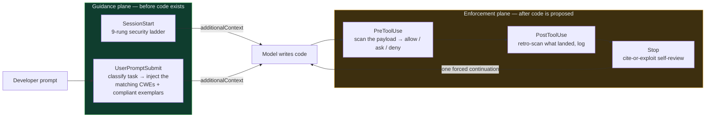
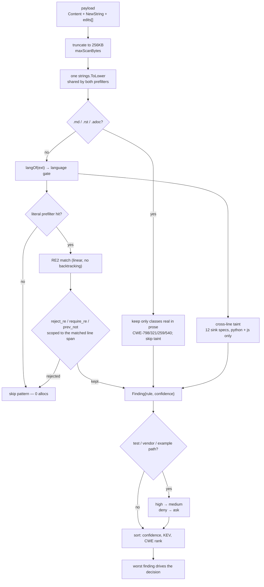
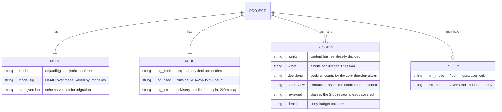
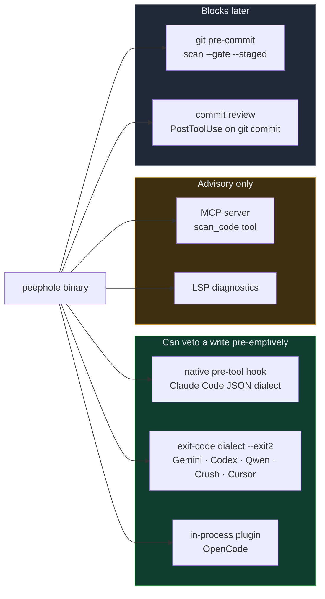
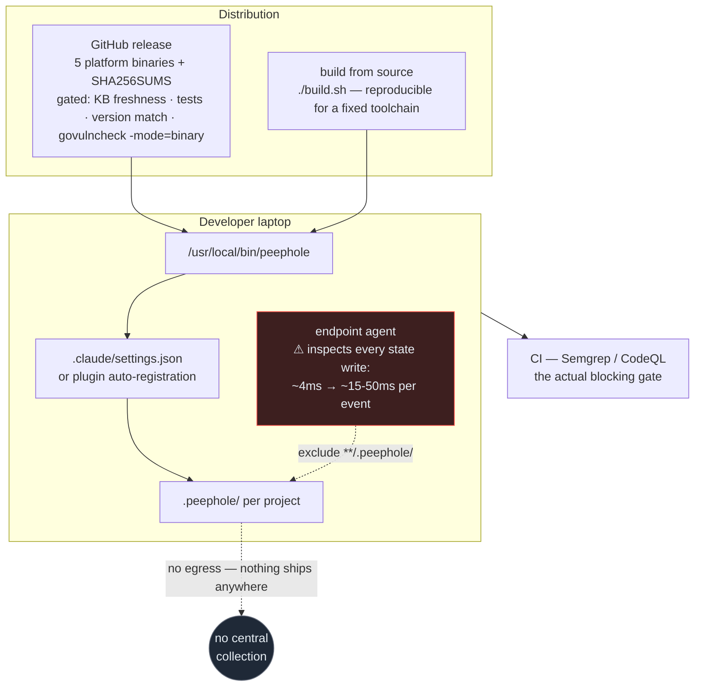
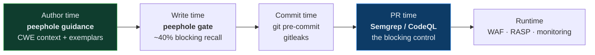

# Peephole — architecture

Diagrams and deployment topology. For the rationale behind each design decision
see [DESIGN.md](DESIGN.md); for adversary analysis see
[THREAT_MODEL.md](THREAT_MODEL.md).

The whole system is one static Go binary, invoked once per hook event, with no
daemon, no socket, no network, and no database. Every diagram below describes
process invocations, not services.

---

## 1. The two planes

Peephole has two mechanisms, and they contribute very unequally. Measured on the
live benchmark, the guidance plane does most of the work; the gate is a backstop.



The asymmetry is the point: it is cheaper and more effective to make the model
write the secure version than to catch the insecure one. The gate exists for the
residual.

## 2. Hook lifecycle

```mermaid
sequenceDiagram
    autonumber
    participant H as Agent host
    participant P as peephole (new process per event)
    participant S as .peephole/ state
    participant M as Model

    H->>P: SessionStart
    P->>S: read/migrate state, verifySelf
    P-->>M: ladder + mode banner
    Note over P,S: warmcache detaches to pre-warm<br/>the slopsquat cache (~500ms saved later)

    M->>H: user prompt
    H->>P: UserPromptSubmit
    P->>P: classify(prompt) → ranked CWEs
    P-->>M: attack scenarios + compliant exemplars

    M->>H: proposes Write / Edit / Bash / MCP
    H->>P: PreToolUse (payload on stdin)
    P->>P: prefilter → 584 patterns → taint → refinements
    P->>S: append audit entry, session sets
    alt high confidence, strict/hardened
        P-->>H: permissionDecision = deny
        H-->>M: reason + secure pattern
        M->>H: regenerates
    else guided, or medium
        P-->>H: ask (human prompt; allow under --dangerously-skip-permissions)
    else clean
        P-->>H: allow
    end

    H->>H: write lands on disk
    H->>P: PostToolUse
    P->>P: retro-scan, classify landed semantic classes
    P->>S: record hunk memo + review classes

    M->>H: finishes
    H->>P: Stop
    P->>S: read reviewed classes
    opt untouched semantic class present
        P-->>M: red-team this diff, quote the guard or fix it
    end
```

## 3. Scan pipeline



Two properties worth knowing when reading findings:

- **Only the top-sorted finding drives the decision.** A file with a medium and a
  high finding is decided by the high one; the medium is logged, not surfaced
  separately.
- **Refinements are line-span scoped.** A `reject_re` that would suppress a false
  positive only sees the lines the regex matched, so a sanitizer three lines above
  the sink does not suppress. This cuts both ways — see THREAT_MODEL §5.2 W9.

## 4. State model

Everything peephole persists, per project. There is no global state and no
cross-project index.



State is mode `0600` inside a `0700` directory, gitignored, and **writable by the
agent** — it is not a trust boundary (THREAT_MODEL §3 B4). The audit chain is
unkeyed, so it is evidence of record, not evidence against an adversary.

## 5. Integration topology

The engine is identical everywhere; only the transport and the strength of the
veto differ.



**Important asymmetry between the two hard dialects.** The Claude Code JSON dialect
expresses three outcomes (`allow`/`ask`/`deny`). The exit-code dialect has two: `2`
blocks, everything else passes. So on exit-code hosts every `ask` becomes an
`rc=0` allow plus a stderr line, which means the `ask` tier — and the whole
uninspectable-write surface — is unenforced there. Since `guided` emits only
`ask`, **the default mode blocks nothing on exit-code hosts.**

## 6. Fleet deployment



Two facts a rollout plan must account for:

- **There is no telemetry.** No egress path exists in the codebase. A security team
  gets per-developer local logs with no file paths, no user identity, and no
  central view. Any fleet reporting must be built separately.
- **Exclude `**/.peephole/` from on-access scanning.** Peephole performs ~5–7 file
  operations per gated event; on an AV-managed endpoint each costs ~3–5ms instead
  of ~0.05ms, which is the entire difference between ~4ms and ~15–50ms per event.
  Rule evaluation itself is ~0.33ms.

## 7. Where peephole sits in a security program



Peephole owns the leftmost two stages and is strongest at the first. It does not
replace stage D — held-out blocking recall is ~40%, and whole classes (missing
authorization, broken business logic, cross-file dataflow) are outside what a
per-hunk engine can prove. Deploy it to reduce what reaches CI, not to replace CI.
