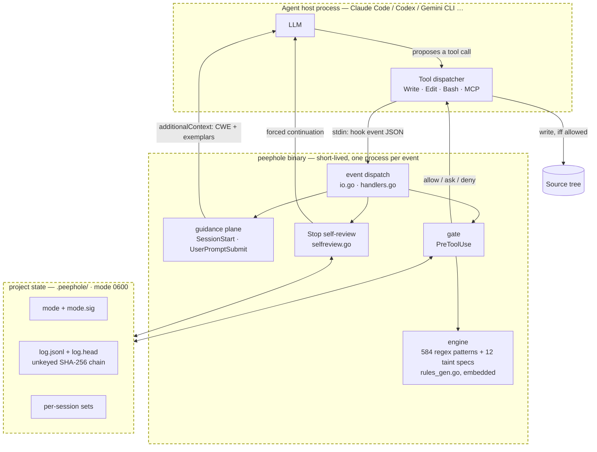
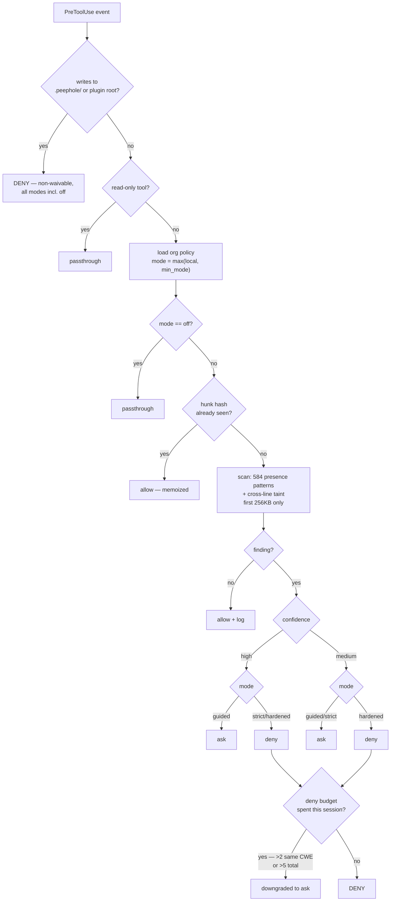

# Peephole — threat model

Scope: peephole 0.5.0. This document states what peephole defends, what it does
**not** defend, and the verified status of every attack we know of against it.
Findings marked MITIGATED were reproduced before and after the fix; findings marked
OPEN are reproducible today. Nothing here is aspirational.

The single most important sentence: **peephole is a guidance and advisory control
with an opportunistic enforcement gate. It is not a security boundary.** An agent
running with the developer's privileges can disable it. Everything below follows
from that.

---

## 1. Assets

| # | Asset | Why an attacker wants it |
|---|---|---|
| A1 | The developer's source tree | Land exploitable code that ships to production |
| A2 | The developer's workstation | Code execution via a write the agent performs |
| A3 | Credentials in the environment | Exfiltrate via code the agent writes |
| A4 | The enforcement decision | Suppress a deny so insecure code lands |
| A5 | The audit log | Erase evidence that a decision happened |
| A6 | The rule corpus / binary | Disable detection wholesale, silently |
| A7 | The supply chain (installed deps) | Introduce a malicious package via a manifest edit |

## 2. Actors

| Actor | Capability | In scope? |
|---|---|---|
| **T1 — Careless agent** | Writes insecure code with no adversarial intent. The overwhelmingly common case. | **Primary** |
| **T2 — Misled agent** | Follows injected instructions from fetched content, a README, an MCP response, or a poisoned rules file. | **Yes** |
| **T3 — Adversarial prompt** | A user deliberately steering the agent to bypass the gate. | Partially |
| **T4 — Same-user local process** | Anything running as the developer, including the agent's own shell. | **Out of scope** (documented) |
| **T5 — Root / malicious insider with admin** | Full host control. | Out of scope |
| **T6 — Upstream supply chain** | Compromise of the peephole distribution itself. | Partially — integrity, not authenticity |

T4 is the load-bearing exclusion. The agent *is* a same-user process, so any
"bypass" reachable by an agent that is trying is not a defect in the security
model — it is the security model. What the model does require is that a bypass be
**loud**: logged, or surfaced, or requiring an obviously suspicious action.

## 3. Architecture and trust boundaries



Boundaries, and what actually crosses them:

| Boundary | Crossing | Trust |
|---|---|---|
| **B1** Model → tool dispatcher | Proposed tool call | Untrusted — this is the thing being gated |
| **B2** Host → peephole | Hook event JSON on stdin | Semi-trusted: shape is host-controlled, content is model-controlled |
| **B3** peephole → host | `permissionDecision`, or exit code 2 | Trusted by the host; **advisory only if the host ignores it** |
| **B4** peephole ↔ `.peephole/` | Mode, audit log, session sets | **Same-privilege — not a boundary.** Writable by the agent |
| **B5** Rules → engine | Compiled into the binary via `go:embed` | Trusted; tampering changes the binary hash |
| **B6** Org policy → gate | `.peephole-policy.json` in the repo | Semi-trusted: escalation-only, but **deletable** |

**B4 is not a boundary and must not be described as one.** It is the reason the
audit log is evidence-of-record, not evidence-against-an-adversary.

## 4. Decision flow



Two properties of this flow are load-bearing and non-obvious:

- **The deny budget silently converts denies to asks** after ~2 same-CWE or ~5
  total denies in a session. An org-mandated `enforce` deny is exempt; ordinary
  denies are not. A session that legitimately touches several CWE classes ends up
  advisory without telling the human.
- **`ask` is not a block.** On Claude Code it is a prompt a human can approve; with
  `--dangerously-skip-permissions` it is an allow; on exit-code hosts it is
  `rc=0` plus a stderr line most hosts never surface. Since `guided` (the default)
  emits only `ask`, **the default configuration blocks nothing** except
  self-protection and org mandates. This is intentional and documented — but it
  means "peephole is installed" and "writes are gated" are different statements.

## 5. Attack inventory — verified status

Every row was reproduced against the shipped binary.

### 5.1 Suppressing a decision (A4)

| ID | Attack | Status |
|---|---|---|
| E1 | `peephole mode off` written literally in a Bash command | **MITIGATED** — self-protection denies, non-waivable, and bypasses the deny budget (verified 8/8 denies in one session) |
| E2 | `set -- mode off; peephole "$@"` (argv indirection) | **OPEN** — `resolveAssignments` handles `VAR=val`, not positional params, so the mode-lowering regex never matches |
| E3 | Write a `.sh` containing the disable, then run it | **OPEN** — the write path checks the target path, never the content |
| E4 | 8 further indirections (shell function, env var, xargs, `sh -c`, backgrounding, …) | **OPEN** |
| E5 | Delete `.peephole/` to reset state | **MITIGATED for enforcement** (missing state fails safe to `guided`), **OPEN for evidence** — the log is destroyed with no alarm; `git clean -xfd` does it |
| E6 | Delete the org policy file, then lower the mode | **OPEN** — policy is repo-local with no out-of-repo path |
| E7 | Write `~/.claude/settings.json` to unregister the hook | **OPEN** — one call, no security-shaped content, permanent, and the org floor cannot help because the hook no longer runs |
| E8 | Exhaust the deny budget with false positives, then land a real finding | **OPEN by design** — mitigated only for org-mandated CWEs |

### 5.2 Landing code without inspection (A1)

| ID | Attack | Status |
|---|---|---|
| W1 | Heredoc, `echo`/`printf` literal redirect, `python3 -c` write | **MITIGATED** — extracted and scanned through the same engine |
| W2 | `printf '\151\155\160…' > f` (octal/hex escapes) | **OPEN** — `unescapeShell` does not decode `\NNN`/`\xNN`, and the extracted literal is then treated as inspected-and-clean, suppressing the uninspectable flag |
| W3 | `curl -o`, `wget -O`, `scp`, `install`, `unzip`, `tar x` | **OPEN** — silent allow; 19 of 40 tested Bash write vectors are silent |
| W4 | `cp` / `mv` from a staged temp file | **MITIGATED to `ask`** — flagged uninspectable |
| W5 | Split a vulnerable statement across two `Edit` calls | **OPEN** — the gate sees only `new_string`, never the resulting file. This is the *normal* multi-step edit path, not an evasion |
| W6 | Payload beyond byte 262,144 | **OPEN** — outside the hot-path window, and the write-family retro-scan uses the same bound |
| W7 | Hunk-memo laundering: write bytes to `s.yaml`, then the same bytes to `app.py` | **MITIGATED** — memo is now language-scoped |
| W8 | MCP `move_file` / `copy_file` / base64 content | **OPEN** — `handleUnknownWrite` has no uninspectable branch |
| W9 | Variable indirection (build the string, then call the sink) | **PARTIALLY MITIGATED** — the taint engine covers Python/JS from recognized sources; Go, PHP, Java, Ruby, C# get no taint analysis, and a value arriving as a function parameter is missed |

### 5.3 Evidence integrity (A5)

| ID | Attack | Status |
|---|---|---|
| L1 | Rewrite log entries and recompute the chain | **OPEN — accepted.** The fold is unkeyed SHA-256 with no secret. A 60-entry log with a committed checkpoint was rewritten and `peephole audit` reported "log chain: intact" |
| L2 | Delete the log entirely | **OPEN** — `audit` reports "no decision log yet" with no alarm |
| L3 | Truncate the tail | **MITIGATED** — detected, *if* `log.head` is left in place |

**Consequence:** the audit log is a local development record. It must not be
presented as compliance evidence or tamper-*proof*; `audit.go` is candid that it
provides integrity, not authenticity, and clause B4 above explains why that is the
ceiling. Do not put it in an audit narrative.

### 5.4 Detection integrity (A6)

| ID | Attack | Status |
|---|---|---|
| I1 | Edit `rules/*.json` to remove a rule | **MITIGATED** — rules are `go:embed`ed; editing the JSON does not affect a built binary |
| I2 | Replace the binary with an always-allow stub | **DETECTED, NOT PREVENTED** — `verifySelf` compares against `bin/manifest.sha256`, a plaintext 0644 file next to the binary; both are rewritable in two commands. The check runs at SessionStart only and never gates a decision |
| I3 | Rename a file's extension to dodge language-scoped rules | **OPEN** — `.py` → `.go` makes the identical Python SQLi invisible, since taint is gated to python/javascript/unknown |
| I4 | Poison instruction files with bidi/homoglyph characters | **MITIGATED** — Unicode scanner alarms on instruction files, user rules, and org policy |

### 5.5 Availability and fail-open

| ID | Condition | Behaviour |
|---|---|---|
| F1 | No binary for the platform | **Fail-open**, exit 0, notice to stderr |
| F2 | Malformed / unexpected event JSON | **Fail-open**, exit 0, `{}` |
| F3 | Host payload shape drift by one field type | **Fail-open** |
| F4 | Unwritable state dir | Enforcement still correct; audit log silently lost |
| F5 | Internal error mid-decision | Fail-**closed** (2s watchdog) |

Fail-open is the correct default for a developer-workflow tool — a security tool
that bricks the workflow gets uninstalled — but F1–F3 mean **"installed" does not
imply "running."** Nothing surfaces silent inactivity to a human except the
Stop-time zero-decision alarm, which only fires if writes occurred *and* the hook
ran.

## 6. Supply chain

| Property | Status |
|---|---|
| Third-party module dependencies | **Zero.** No `require`, no `go.sum`, no vendor tree, 0 non-stdlib packages linked (`sbom/peephole.cdx.json`) |
| Entire external attack surface | The Go standard library, statically linked |
| Toolchain currency | **Security-relevant.** Binaries built on go1.26.0 were reachable-affected by **1** stdlib vulnerability (GO-2026-4602, Root escape via `os.ReadDir`, fixed in go1.26.1) and were 6 patches stale. Now pinned in `go.mod` and `release.yml`, gated by an artifact toolchain assertion plus govulncheck against an unstripped scan build. NB `govulncheck -mode=binary` over-reports ~32x on stripped binaries — see docs/SECURITY_ASSESSMENT.md SA-0 |
| Release integrity | SHA256SUMS published per release; builds reproducible **for a fixed toolchain version** |
| Release authenticity | **None.** No signing, no provenance attestation, no SLSA. A self-consistent poisoned build passes `selfcheck` |
| Licence | MIT. Go stdlib BSD-3-Clause attribution in `NOTICE` |

The most important supply-chain lesson here is structural: *zero dependencies does
not mean zero supply chain.* It concentrates the entire supply chain into one
input — the compiler — and source-mode vulnerability scanning cannot see that
input, because it resolves the stdlib from whatever toolchain the scanner is
running under. Artifacts must be scanned as artifacts.

## 7. Residual risk register

Ranked by expected impact for the intended deployment (developer laptops, `guided`
mode, agent-authored code).

| Risk | Likelihood | Impact | Disposition |
|---|---|---|---|
| R1 Insecure code lands because detection missed it (~40% blocking recall held out; Go 11%, PHP 0% before 0.5.0 rules) | High | Medium | **Accept** — pair with CI SAST. This is a guidance tool, not a gate |
| R2 Developer-blocking false positive drives org-wide disable | Medium | High | **Mitigated** — `guided` default never hard-blocks; ~50–67% of *deny*-level findings were false before the 0.5.0 precision work |
| R3 Agent disables enforcement (E2/E3/E4/E7) | Medium | Medium | **Accept & disclose** — same-user model. Do not claim enforcement guarantees |
| R4 Audit log presented as compliance evidence | Medium | High | **Must not do.** Documentation control only |
| R5 Stale build toolchain ships CVEs | Was High | Medium | **Mitigated** — pinned + artifact-scanned in CI |
| R6 No release signing | Low | High | **Open** — accept for internal use; blocker for public distribution |
| R7 Single maintainer, bus factor 1 | High | Medium | **Accept** — MIT, forkable, zero deps makes a fork cheap |
| R8 Latency on AV-managed endpoints (~15–50ms/event) | High | Low | **Mitigated** — exclude `**/.peephole/` from on-access scanning |

## 8. Explicit non-goals

Peephole does **not** claim, and must not be deployed as if it claims:

1. Prevention of insecure code by a *motivated* agent or user.
2. Tamper-**proof** audit. Tamper-*evident*, against accident and casual overwrite.
3. Whole-repo or cross-file analysis. It sees one hunk plus a bounded diff.
4. Proof of missing controls (authz, CSRF, rate limits). It advises; the Stop
   review prompts; neither verifies.
5. A SAST replacement. It is a pre-generation and write-time layer.
6. Fleet enforcement. Org policy is repo-local and deletable.

## 9. How to re-verify this document

```sh
go test ./... -count=1                                     # behaviour
go test -run '^$' -bench 'LoadKB|Scan|Hot' -benchmem        # latency components
go build -o /tmp/scan-target . && govulncheck -mode=binary /tmp/scan-target   # expect 0
                                                            # (UNSTRIPPED: binary mode
                                                            # over-reports on -s -w)
python3 sbom/generate.py bin/peephole-darwin-arm64          # dependency claims
trivy fs --scanners vuln,secret,license .                   # secrets are synthetic fixtures only
```

The attack table in §5 is reproducible by driving the binary directly:

```sh
printf '%s' '{"hook_event_name":"PreToolUse","tool_name":"Bash","cwd":"<proj>",
  "tool_input":{"command":"<vector>"}}' | CLAUDE_PLUGIN_ROOT=<root> peephole hook
```
